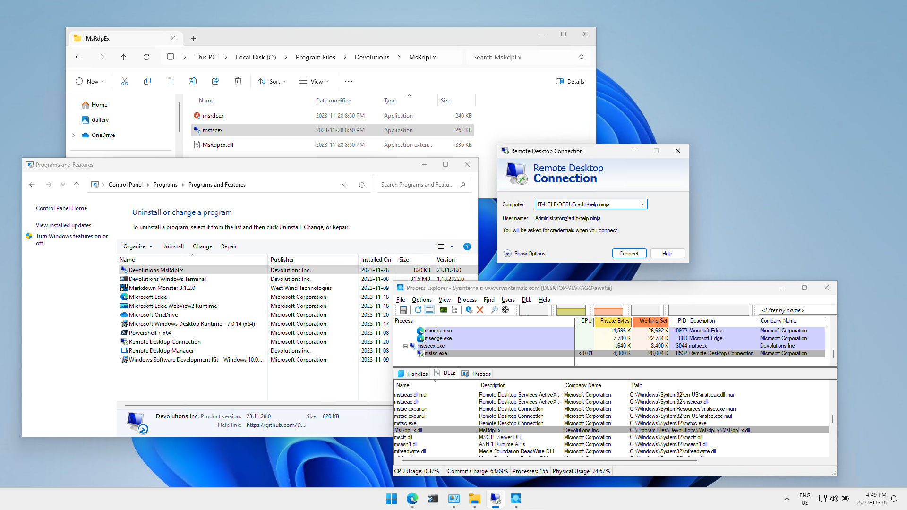

# Microsoft RDP Extensions (MsRdpEx)

## Installation

Download and install the latest MsRdpEx MSI package [GitHub releases](https://github.com/Devolutions/MsRdpEx/releases).

After installation, the launcher executables and API hooking DLL can be found in "%ProgramFiles%\Devolutions\MsRdpEx":



The installer automatically associates .RDP files with mstscex, and .RDPW files with msrdcex, so you can get started right away. Simply revert the file type association to use the original Microsoft Remote Desktop Clients without the extensions, or launch mstsc.exe/msrdc.exe manually.

This repository also contains a C# [nuget package](https://www.nuget.org/packages/Devolutions.MsRdpEx) that can be used to consume the RDP ActiveX interface with or without API hooking, along with launching mstsc.exe or msrdc.exe as external processes using MsRdpEx.dll.

### COM interop selection

The package selects legacy COM interop by default, preserving the original `Interop.MSTSCLib.dll` and `AxInterop.MSTSCLib.dll` APIs for both .NET Framework 4.8 and `net8.0-windows` consumers:

```xml
<PackageReference Include="Devolutions.MsRdpEx" Version="..." />
```

Set `MsRdpExComInterop` to `Generated` to reference the source-generated, NativeAOT-compatible `Interop.MSTSCLib.Generated.dll` instead:

```xml
<PropertyGroup>
  <MsRdpExComInterop>Generated</MsRdpExComInterop>
</PropertyGroup>
```

For a WinForms ActiveX host alongside the standalone generated projection, set `MsRdpExGeneratedWinForms` separately:

```xml
<PropertyGroup>
  <MsRdpExComInterop>Generated</MsRdpExComInterop>
  <MsRdpExGeneratedWinForms>true</MsRdpExGeneratedWinForms>
  <UseWindowsForms>true</UseWindowsForms>
</PropertyGroup>
```

This adds `Interop.MSTSCLib.Generated.WinForms.dll`, whose `MsRdpEx.WinForms.GeneratedRdpClientHost` hosts a generated RDP proxy with a configurable CLSID, ActiveX DLL name, and optional MsRdpEx DLL path; call `GetClient<T>()` after the control is created. It is a WinForms-only feature and is not NativeAOT-compatible.

`GeneratedWinForms` remains available for applications moving to the generated projection that require its `AxMSTSCLib` wrapper types. Existing legacy `AxMSTSCLib` consumers remain on the default `Legacy` mode. Set `MsRdpExComInterop` to `None` when an application needs neither interop assembly.

Packages that ship generated assets expose `MsRdpExGeneratedInteropSupported=true`, `MsRdpExGeneratedWinFormsInteropSupported=true`, and `MsRdpExGeneratedWinFormsHostSupported=true` after the package targets are imported. Selecting a generated mode or host validates that its assembly is present and fails with a clear package capability error otherwise.

#### Legacy and generated API compatibility

`Generated` preserves the public `MSTSCLib` interface names and enums from the legacy assembly. It uses source-generated COM interfaces internally, so raw `MsRdpEx.Interop` interfaces expose explicit `GetX` and `SetX` methods; use the `MSTSCLib` compatibility interfaces and extensions for property-shaped APIs. `MSTSCLibExtensions` provides conventional methods for extended-settings values, endpoint and publisher-certificate-chain configuration, byte-preserving load-balance information, generated interface conversion, and drive, device, and camera collection lookups.

Use `RdpClientFactory.CreateClient10()` to activate the Microsoft RDP Client Control version 11 without legacy coclasses. The returned compatibility interface can use `Subscribe()` to obtain an `RdpClientEventSubscription`; dispose it to unadvise the COM connection point. The subscription exposes all legacy `IMsTscAxEvents` callbacks as managed events, including mutable confirmation, public-key, and auto-reconnect response event arguments for COM by-ref callbacks. This runtime API requires Windows and an apartment-threaded caller.

The NativeAOT package-consumer fixture accepts `--com-integration` to check activation, generated proxy invocation, and event Advise/Unadvise behavior without opening a remote connection. It exits with code `77` and prints `SKIPPED` when the RDP Client Control version 11 is not registered.

The generated assets deliberately do not provide legacy COM coclasses (such as `MsRdpClient10Class`), classic `*_Event`/`SinkHelper` event helpers, or MIDL implementation-detail types. Use `Legacy` when an application needs those APIs. The additive WinForms host has the same generated interop boundary; `GeneratedWinForms` instead adds the older `AxMSTSCLib` host controls.

The legacy and generated assets define overlapping `MSTSCLib` type names and cannot be referenced by the same application. Select exactly one `MsRdpExComInterop` mode per project.

### Avalonia RDP view

Avalonia 12 applications can enable the reusable, bitmap-backed
`Devolutions.MsRdpEx.Avalonia.RdpClientView` from the same NuGet package:

```xml
<PropertyGroup>
  <MsRdpExAvalonia>true</MsRdpExAvalonia>
</PropertyGroup>

<ItemGroup>
  <PackageReference Include="Avalonia" Version="12.1.1" />
  <PackageReference Include="Devolutions.MsRdpEx" Version="..." />
</ItemGroup>
```

`MsRdpExAvalonia=true` selects the generated COM projection and references the
packaged `Devolutions.MsRdpEx.Avalonia.dll`. The consuming application keeps
its normal Avalonia package references, so Avalonia is not imposed on existing
WinForms or .NET Framework consumers. `RdpClientView` is an Avalonia
`NativeControlHost`: it parents a real, visible Win32 child window inside the
Avalonia window and activates the RDP ActiveX control in it through MsRdpEx's
own OLE client-site and in-place-site implementation (no Windows Forms
`AxHost` or ATL hosting helpers). The control renders directly to the screen
and receives native keyboard and mouse input — no off-screen HWND, no
framebuffer copy, and no synthetic input forwarding. Use
`Connect(RdpConnectionSettings)` for the convenience API, or `GetClient<T>()`
after `ClientReady` for direct generated MSTSCLib configuration.

## Extended .RDP File Options

MsRdpEx processes additional .RDP file options that are not normally supported by mstsc.exe:

| RDP setting                        | Description            | Values                 | Default value          |
|------------------------------------|------------------------|------------------------|:----------------------:|
| KDCProxyURL:s:value | Kerberos KDC Proxy HTTPS URL | KDC Proxy HTTPS *URL*, not using error-prone KDCProxyName format, and unrestricted in length, like https://<hostname>:443/KdcProxy | - |
| UserSpecifiedServerName:s:value | Server name used for TLS and Kerberos server validation | explicit server name (usually the machine FQDN) | same as DNS hostname used for RDP server |
| EnableMouseJiggler:i:value | Enable RDP mouse jiggler | 0/1 | 0 |
| MouseJigglerInterval:i:value | RDP mouse jiggler interval in seconds | Interval in seconds | 60 |
| MouseJigglerMethod:i:value | RDP mouse jiggler method | 0/1 | 0 |
| AllowBackgroundInput:i:value | Allow background input events when window is not in focus | 0/1 | 0 |
| EnableRelativeMouse:i:value | Enable relative mouse mode | 0/1 | 0 |
| DisableCredentialsDelegation:i:value | Disable CredSSP credential delegation | 0/1 | 0 |
| RedirectedAuthentication:i:value | Enable Remote Credential Guard | 0/1 | 0 |
| RestrictedLogon:i:value | Enable Restricted Admin Mode | 0/1 | 0 |
| DisableUDPTransport:i:value | Disable RDP UDP transport (TCP only) | 0/1 | 0 |
| ConnectToChildSession:i:value | Connect to child session | 0/1 | 0 |
| EnableHardwareMode:i:value | Disable DirectX client presenter (force GDI client presenter) | 0/1 | 1 |
| ClearTextPassword:s:value | Target RDP server password - use for testing only | Insecure password | - |
| GatewayPassword:s:value | RD Gateway server password - use for testing only | Insecure password | - |
| KerbCertificateLogon:i:value | Hand LSASS a KERB_CERTIFICATE_LOGON for smart card logon (see below) | 0/1 | 0 |

### Smart card certificate logon (KerbCertificateLogon)

When a smart card certificate and its PIN are both pre-supplied (an unattended logon, with no
interactive prompt), the CredSSP/SSPI credential that reaches LSASS can take a code path in
`tspkg` that calls `CryptAcquireCertificatePrivateKey` without
`CRYPT_ACQUIRE_ALLOW_NCRYPT_KEY_FLAG`, which fails for keys backed by a CNG/NCrypt key storage
provider (the common case for smart cards). The interactive Windows credential prompt is not
affected, because it packs the credential as a `KERB_CERTIFICATE_LOGON` structure that `tspkg`
handles on a different path.

Setting `KerbCertificateLogon:i:1` opts the session in to a client-side workaround: MsRdpEx hooks
`AcquireCredentialsHandleW` and, for the matching session, supplies a `KERB_CERTIFICATE_LOGON`
in the caller's CredSSP wrapper. Windows-supplied certificate logons are preserved before either
builder is considered, including those in `CredsspSubmitBufferBoth` and extended wrappers.
Repacking an existing credential could lose its selected reader, provider, account hints, or
provider-specific data.

When a replacement is needed, MsRdpEx obtains it either by:

- **synthesizing** it from the session's marshaled certificate user name and PIN — used when the
  host supplies a supported wrapper without the certificate credential in-band; or
- **rewriting** a marshaled smart card credential that is already present in the
  `AcquireCredentialsHandleW` auth data — such as the out-of-process `mstsc.exe` case.

The replacement uses `CredsspSubmitBufferBoth` (type 50), including when the unattended caller
supplies `CredsspSubmitBufferBothOld` (type 51), preserving the caller's Schannel credential and
extended-wrapper fields. Missing (`pAuthData == NULL`), unreadable, or unsupported wrappers are
passed to Windows unchanged, with the reason logged. MsRdpEx does not construct a certificate-only
wrapper when there is no supported wrapper to inherit.

The workaround is strictly opt-in and stays inert unless a nonempty PIN is available: with no PIN the
credential is left untouched so the normal Windows prompt path is used. It only activates for a
marshaled certificate credential; any other credential is passed through unchanged.

By default, newly packed credentials are passed on without changing the provider or container selected by
`CredPackAuthenticationBufferW`. The remote host must be able to resolve and use those names through
smart card redirection. Middleware requirements depend on the card/provider; for example,
[ActivClient requires server-side installation for server-based authentication](https://docs.hidglobal.com/activid-activclient-v8.4/activid-activclient/ac-with-terminal-service/microsoft-remote-desktop-sessions.htm).
A provider/container mismatch can surface as *"the key container does not exist on the smart card"*.
Successful client authentication alone does not prove this remote operation will succeed.

`KerbCertificateLogon` is independent of the private RDP core property `PasswordContainsSCardPin`.
The latter identifies the password field as a smart card PIN; a connection manager doing an
unattended certificate + PIN logon typically sets both. MsRdpEx accepts Boolean or integer variants
for this property, normalizes them to the core Boolean setter, and reports write failures. It does
not force the property on or override the caller's credential-delegation choices. Setting the
property is not, by itself, proof of successful delegation or automatic remote logon.

The captured PIN is kept only for the lifetime of the connection, encrypted in memory with DPAPI
(`CryptProtectMemory`), decrypted only transiently while the credential is built, and zeroed
before it is released. No PINs, passwords, or certificate bytes are logged.

#### Experimental card-context enrichment

`MSRDPEX_SSPI_SMARTCARD_CONTEXT` enables a **developer-controlled experiment**, not a proven fix
for remote Winlogon prompts. It is read before each new `Connect` in the private ActiveX backend:

| Value | Behavior |
|---|---|
| Unset, empty, or `off` | Existing synthesis. No additional certificate-store, reader, or key access. |
| `observe` | Resolve and verify card context before connecting, but leave the packed credential unchanged. |
| `apply` | Perform the same resolution, then add the verified card/reader context to newly synthesized credentials. |

Other values log a warning and disable the experiment. No .RDP option or additional COM property
is introduced. It still requires `KerbCertificateLogon` and a captured, nonempty PIN before
`Connect`; ordinary passwords and Windows-built incoming certificate logons remain unchanged.

The initial resolver is intentionally conservative. It requires the selected certificate in the
current user's `MY` store, an existing **Microsoft Base Smart Card Crypto Provider** or
**Microsoft Smart Card Key Storage Provider** binding, exactly **one present card** across the
reader list, and one registered card name for its ATR. It opens that existing container **scoped to
that reader**, silently, and compares the key's public certificate byte-for-byte with the selected
certificate. It checks reader/card insertion state again before publishing the snapshot.
It does not supply or verify a PIN, sign, decrypt, create keys, heal certificate-store bindings,
switch providers, or retry with UI enabled.

This tests **reader/card context**, not a general KSP-to-CSP migration. The provider, container and
key specification must also match the freshly packed credential. The experiment preserves its PIN
bytes (including any protected representation), account hints, flags, and CredSSP/Schannel wrapper.
Unknown provider-specific data and incompatible layouts are not replaced.

Multiple present cards, ambiguous registration/bindings, absent cards, unsupported middleware,
emulated WinSCard configurations, certificate mismatches and API errors retain existing synthesis
and log **`candidate not applied`**, with a stage and error code. This is not a successful candidate
test. `snapshot prepared (not yet applied)` only confirms resolution; look for
**`candidate applied to synthesized credential`** to confirm the intervention. `observe` performs
the same resolver work to help distinguish provider/cache side effects from the buffer change.
Snapshots are connection-specific and invalidated on PIN changes, explicit disconnect, connection
failure and destruction; a new connection prepares a fresh snapshot. A card can still move or be
removed after preparation; this is not a live reader-monitoring service.

**Operational limitation:** opted-in resolution is synchronous on the connecting thread, before
entering the SSPI acquisition hook. Silent flags suppress provider UI but do not impose a timeout.
Slow or blocked middleware can delay `Connect`; use this only in an approved test environment.
There is no background worker to abandon, forced thread termination, or automatic connection retry.

For an approved test build, fully exit the connection manager, set the mode in its launching
PowerShell window, and launch the same installed/test executable normally. Enable the host's
MsRdpEx DEBUG logging to distinguish a prepared snapshot, an applied candidate and a skipped test:

```powershell
$Env:MSRDPEX_SSPI_SMARTCARD_CONTEXT = "observe" # Repeat separately with "apply"
```

Keep the certificate, correct PIN, connection and target unchanged. Record desktop versus
Winlogon/Other user for observe, apply, then observe again; also retain the unchanged `off` baseline.
Process restart does not necessarily clear per-session PIN caches. An apply success alone does not
isolate causality. Do not test incorrect PINs or enable raw credential dumps. Remove the variable
or use `off` to restore the previous path. Hardware-free tests cannot establish the affected
customer's remote-logon result.

Set the `MSRDPEX_SSPI_SMARTCARD_DEBUG=1` environment variable to emit additional (secret-free)
CredSSP credential metadata to the log while diagnosing smart card logon issues.

### Diagnosing NLA success without desktop logon

NLA authentication, CredSSP credential delegation, and remote interactive logon are separate stages.
A successful SSPI call or an RDP connection ending at "Other user" does not prove that the remote
host received and could use the intended smart card logon. Compare a pre-supplied-PIN failure with
a successful Windows-prompted-PIN connection using the same card, account, client, and target.

Builds containing the diagnostics from #177/#178 already log credential metadata at DEBUG; a new
DLL is not needed for an initial paired capture. Confirm the **loaded** MsRdpEx and ActiveX DLL
versions and process architecture, not just the connection manager version. Before starting a fresh
connection-manager process, set:

```powershell
$Env:MSRDPEX_LOG_ENABLED = "1"
$Env:MSRDPEX_LOG_LEVEL = "DEBUG"
$Env:MSRDPEX_SSPI_SMARTCARD_DEBUG = "1"
$Env:MSRDPEX_SSPI_DUMP = "0"
$Env:MSRDPEX_PCAP_DUMP = "0"
```

Use one connection per capture and a separate `MSRDPEX_LOG_FILE_PATH` for each attempt. Verify that
the host has not overridden logging or enabled packet capture. Record the failure before manually
logging on, and note any existing session or PIN-cache reuse.

Compare `CredSSP auth metadata`, `KerbCertificateLogon(incoming)`, `KerbCertificateLogon(credpack)`,
the selected builder/session resolution, and subsequent SSPI status records. Provider, container,
reader, card, key specification, and account-field lengths can distinguish the paths. If an incoming
allocation's size is unknown, variable-length CSP data is deliberately not parsed: missing fields
in that diagnostic are not evidence that the credential itself omitted them.

Correlate the attempt with session-host Security events 4624/4625 (including logon type and
status/substatus), RemoteConnectionManager/LocalSessionManager events, and DC events 4768/4771.
A 4624 **type 10** for the intended user indicates remote interactive logon; 1149, a type 3 logon,
or a client-origin PKINIT alone does not. Verify audit configuration and account for caching and
proxies before treating absent events as meaningful. Inspect effective smart card redirection,
delegation, and prompt policies without changing them.

If the paired logs are insufficient, use approved
[Windows smart card diagnostics](https://learn.microsoft.com/en-us/windows/security/identity-protection/smart-cards/smart-card-debugging-information)
to locate provider/key-access or server-logon failure. Card enumeration alone does not prove private-key
use, and a server-console test is not equivalent to redirected logon. Keep raw SSPI and plaintext
packet dumps off; do not collect PINs, auth buffers, or LSASS/process dumps. Logs and traces can
still identify users, certificates, containers, and infrastructure and require sensitive-data handling.

## Extended RDP client logs

MsRdpEx also supports extended logging controlled by environment variables:

```powershell
$Env:MSRDPEX_LOG_ENABLED="1"
$Env:MSRDPEX_LOG_LEVEL="DEBUG"
.\mstscex.exe <destination.rdp>
```

If you don't pass a .RDP file, the mstsc.exe GUI will launch normally, but you won't be able to leverage any of the extended MsRdpEx .RDP file options. The default log file path location is in "%LocalAppData%\MsRdpEx\MsRdpEx.log". You can override log settings using the MSRDPEX_LOG_LEVEL and MSRDPEX_LOG_FILE_PATH environment variables:

```powershell
$Env:MSRDPEX_LOG_ENABLED="1"
$Env:MSRDPEX_LOG_LEVEL="TRACE"
$Env:MSRDPEX_LOG_FILE_PATH="C:\Windows\Temp\MsRdpEx.log"
.\mstscex.exe
```

The trace log level is extremely verbose, so it should only be used when necessary. The MsRdpEx logging is very helpful in understanding the Microsoft RDP client internals.

### RD Gateway isolation

RPC binding isolation is enabled by default for Microsoft RDP ActiveX gateway
connections using `ncacn_http`. It resolves a confirmed case where the second
connection in the same process failed while the first remained connected.
Hosts can disable it process-wide with `RdpCoreApi.GatewayIsolationEnabled = false`
before connecting. See [gateway isolation](tests/logging/GatewayIsolation.md) for
scope, compatibility, lifecycle and validation details. Native logging is not required.

## Public ActiveX backends

Set `MSRDPEX_AX_BACKEND=public` for a non-Microsoft `mstscax`-compatible replacement selected by `MSRDPEX_MSTSCAX_DLL`. MsRdpEx also automatically uses public mode when that replacement DLL is named `ironrdpax.dll`, unless `MSRDPEX_AX_BACKEND` is explicitly set. MsRdpEx continues to load the replacement DLL and forward its public COM class factory, but does not inspect the replacement client's undocumented Microsoft object layout.

Public mode intentionally disables private extended-settings/property hooks and extended `.RDP` option processing, input/output window association (including output mirroring and recording), SSPI session correlation, and other features that depend on Microsoft private ActiveX internals. The default `private` mode retains standard `mstscax.dll` behavior. Any explicit backend value other than `public` retains private mode; automatic `ironrdpax.dll` detection applies only when the backend option is unset.

## Building from source

Generate the Visual Studio project files for your target platform:

```powershell
mkdir build-x64 && cd build-x64
cmake -G "Visual Studio 18 2026" -A x64 ..
```

Open the Visual Studio solution or build it from the command-line:

```powershell
cmake --build . --config Release
```

You should now have mstscex.exe and MsRdpEx.dll.
